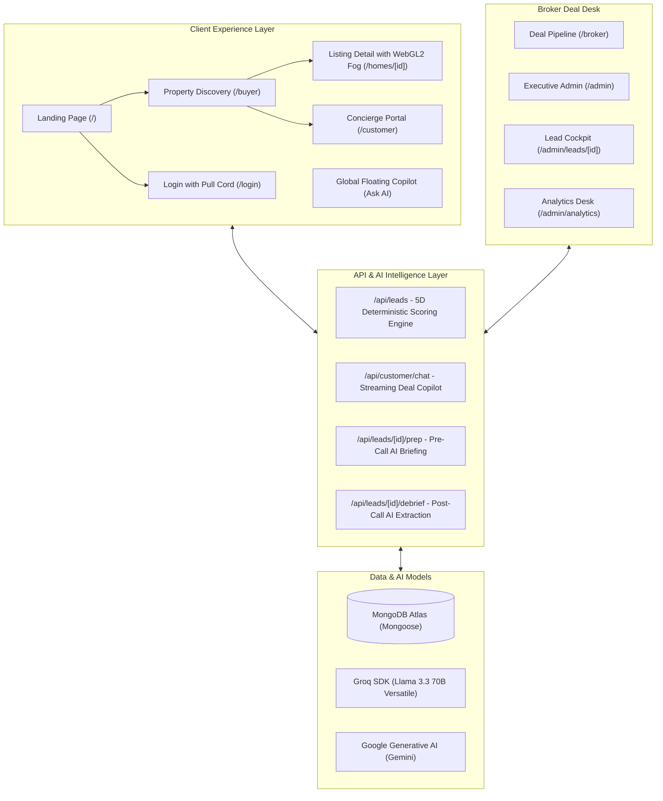

<div align="center">

# 🏛️ Prospera AI
### Autonomous Luxury Real Estate Deal Room & Client Intelligence Engine

[-black?style=for-the-badge&logo=next.js&logoColor=white)](https://nextjs.org/)
[](https://react.dev/)
[](https://tailwindcss.com/)
[](https://www.typescriptlang.org/)
[](https://www.mongodb.com/)
[](https://groq.com/)
[](https://www.framer.com/motion/)

<p align="center">
  <b>A cinematic, full-bleed luxury property marketplace married with an enterprise AI deal desk.</b><br/>
  Automated 5-dimension lead scoring, real-time negotiation pipelines, WebGL2 architectural fog shaders, Verlet physics pull-cord illumination, and autonomous concierge matching.
</p>

<p align="center">
  <a href="#-overview">Overview</a> •
  <a href="#-key-experiences--portals">Key Experiences</a> •
  <a href="#-signature-motion--physics-systems">Motion & Physics</a> •
  <a href="#-architecture--data-flow">Architecture</a> •
  <a href="#-tech-stack">Tech Stack</a> •
  <a href="#-quick-start">Quick Start</a> •
  <a href="#-rbac--security">RBAC & Security</a>
</p>

---

</div>

## 🌟 Overview

**Prospera AI** re-engineers high-value residential and commercial real estate transactions. Outdated manual spreadsheets and clunky CRMs are replaced by a unified, synchronized dual-sided ecosystem:

1. **For Advisory Brokers & Deal Leads (`/admin`, `/broker`):** An autonomous deal desk featuring deterministic 0–99 AI lead qualification, staleness decay tracking, one-click pre-call briefings (icebreakers, discovery questions, rebuttals), automated post-call debrief CRM extraction, and executive portfolio analytics.
2. **For High-Net-Worth Buyers & Clients (`/buyer`, `/customer`, `/`):** A cinematic, editorial marketplace with natural-language property discovery, custom AI matching pitches, live transaction milestone timelines, and on-demand priority escalation.

---

## ✨ Key Experiences & Portals

### 1. 🏙️ Cinematic Editorial Marketplace (`/`)
* **3-Slide Hero Wipe:** Full-bleed architectural imagery with giant gradient-faded typography, drifting volumetric clouds, and soft right-to-left wipe transitions.
* **Orbital City Rail:** Interactive radial hubs for tier-1 luxury hubs (Mumbai, Bengaluru, Hyderabad, Pune).
* **Luxury Search Pill:** Natural language search bar with contextual AI suggestions, BHK filters, and price ranges.
* **Shared-Element Flight:** Seamless hero-card-to-modal transition with zero layout shift.

### 2. 💡 Interactive Pull Cord Ceiling Lamp (`/login`)
* **Verlet Rope Simulation:** Authentic 12-segment rope integration with gravity ($2600\,\text{px/s}^2$), 4 sub-steps per frame, and 8 distance constraint passes.
* **Expanding Circular Light Wave:** Tugging the porcelain bead pops the golden `#ffd23f` filament bulb, surging a radial `clip-path` light wave across the room to toggle between **Obsidian Night** (`#0a0d12`) and **Warm Dusk** (`#fbe7da`).
* **Tactile Spring Tuning:** Exact spring dynamics (`TH` 46/3 sway, `TUG` 300/13 bounce, `R` 120/21 light wave, `BP` 420/13 bulb pulse) with critical damping under `prefers-reduced-motion`.
* **Full Accessibility:** Pointer capture dragging, tap toggle, and keyboard activation (`role="switch"`, `aria-checked`).

### 3. 🌫️ WebGL2 Morning / Night Fog Hero (`/homes/[id]`)
* **Three-Layer Parallax Composition:** Fixed atmospheric sky, Y-axis building/garden plane, and live WebGL2 fragment shader fog canvas.
* **Dynamic Time Shift:** Activating the glass morning/night toggle sinks the estate into rising mist, swaps the lighting environment, and floats the residence back up in the new light.
* **Shader Fog Simulation:** Procedural noise-driven volumetric fog waves with configurable density, turbulence, and color blending.

### 4. 🤖 Global AI Copilot ("Ask AI")
* **Gooey Spring Pill:** Fixed bottom-right chat launcher that expands from an elegant compact pill into a 320px search/chat cockpit.
* **Staggered Suggestion Bubbles:** Rising contextual prompts (120ms blur-to-sharp stagger) tuned to the user's active page and selected estate.
* **Streaming Deal Room Intelligence:** Real-time conversational AI streaming powered by Groq (Llama 3.3 70B) and Gemini, providing instant property analysis, legal breakdown, and investment yield projections.

### 5. 🏢 Broker Deal Desk & Lead Hub (`/admin`, `/broker`)
* **Deterministic 5-Dimension Lead Scoring:** Algorithmically evaluates inquiries across *Intent*, *Timeline*, *Budget*, *Engagement*, and *Data Completeness*, applying decay penalties for uncontacted leads.
* **One-Click Pre-Call Prep:** Generates customized conversation agendas, personalized icebreakers, and risk mitigation strategies based on client history.
* **Instant Call Debrief:** Converts unstructured broker voice/text notes into structured CRM updates, adjusting lead temperature (*Hot*, *Warm*, *Cold*) dynamically.
* **Executive Recharts Analytics:** Visual tracking of active portfolio value, conversion velocity, and pipeline distributions.

### 6. 🛋️ Client Concierge Portal (`/customer`)
* **Live Deal Milestones:** Real-time stage tracking from initial offer and document verification to escrow and final registration.
* **Priority Escalation:** Client-triggered priority trigger that instantly flags deals as *Urgent Attention* on broker dashboards.

---

## 🎨 Signature Motion & Physics Systems

```
┌────────────────────────────────────────────────────────────────────────┐
│ <PullCord /> Verlet Rope & Light Engine                                 │
├────────────────────────────────────────────────────────────────────────┤
│ • 12 Verlet nodes, 4 physics sub-steps, 8 relaxation iterations        │
│ • 7 tuned springs: TH (angle), TUG (bounce), R (light), BP (bulb)     │
│ • Expanding circular clip-path light flood from filament center        │
│ • Obsidian Night (#0a0d12) ⟷ Warm Dusk (#fbe7da) theme sync           │
└────────────────────────────────────────────────────────────────────────┘
                                    │
                                    ▼
┌────────────────────────────────────────────────────────────────────────┐
│ <GenerateButton /> Kinetic AI Action Standard                          │
├────────────────────────────────────────────────────────────────────────┤
│ • Dual-layer glowing inner bevel with translucent specular rim         │
│ • Dynamic hue-driven highlight gradient (37° amber / 265° purple)      │
│ • Halo ring pulse (::before) & sequential letter-by-letter wave        │
│ • Reserved strictly for real generative AI actions                     │
└────────────────────────────────────────────────────────────────────────┘
                                    │
                                    ▼
┌────────────────────────────────────────────────────────────────────────┐
│ WebGL2 Listing Fog Shader                                              │
├────────────────────────────────────────────────────────────────────────┤
│ • Custom fragment shader rendering noise-driven volumetric mist       │
│ • 3-layer parallax: static sky, floating estate, top-level fog         │
│ • 1800ms synchronized sink-and-rise time-of-day transition             │
└────────────────────────────────────────────────────────────────────────┘
```

---

## 🏗️ Architecture & Data Flow



---

## 💻 Tech Stack

| Domain | Technology | Purpose |
| :--- | :--- | :--- |
| **Framework** | **Next.js 16.3.6 (Turbopack)** | App Router, Server Actions, API routes, Turbopack builds |
| **UI Library** | **React 19.2.8** | Server & Client Components, React Compiler compatibility |
| **Styling** | **Tailwind CSS 4.0** | High-performance CSS engine, custom theme tokens |
| **Language** | **TypeScript 5** | Strict type safety across client, server, and AI schemas |
| **Motion** | **Framer Motion 14.9** | Spring physics, layout animations, exit transitions |
| **Shaders** | **WebGL2 (GLSL)** | Volumetric procedural fog shader on listing details |
| **Physics** | **Custom Verlet Solver** | Multi-node rope physics with constraint relaxation |
| **Database** | **MongoDB 9.10 / Mongoose** | Persistent storage for leads, inventory, and deals |
| **AI Inference** | **Groq SDK & Google Gemini** | Ultra-low-latency Llama 3.3 70B & Gemini deal copilot |
| **Charts** | **Recharts 3.10** | High-contrast executive portfolio analytics |
| **Auth & Security** | **Jose & Bcrypt.js** | Stateless JWT tokens with HTTP-only cookies and RBAC |
| **Icons** | **Lucide React** | Clean, minimalist iconography |

---

## 🚀 Quick Start

### Prerequisites
- **Node.js**: v20.0.0 or higher
- **MongoDB**: Local MongoDB instance or free MongoDB Atlas URI
- **Groq API Key**: (Optional for AI copilot actions, get one at [console.groq.com](https://console.groq.com/))

### 1. Clone & Install
```bash
git clone https://github.com/your-username/prospera-ai.git
cd prospera-ai
npm install
```

### 2. Configure Environment Variables
Create a `.env.local` file in the root directory:
```env
# AI Intelligence Engine
GROQ_API_KEY=your_groq_api_key_here
GROQ_MODEL=llama-3.3-70b-versatile

# Database Persistence
MONGODB_URI=mongodb://localhost:27017/prospera-ai

# Security & Authentication (minimum 32-character secret)
JWT_SECRET=super_secret_jwt_key_must_be_at_least_32_characters_long

# Application Base URL
NEXT_PUBLIC_APP_URL=http://localhost:3000
```

### 3. Seed Database
Populate verified properties and sample deal room leads:
```bash
npx tsx scripts/seed.ts
```

### 4. Run Development Server
```bash
npm run dev
```
Open **[http://localhost:3000](http://localhost:3000)** in your browser.

### 5. Production Build & Lint
```bash
# Typecheck
npx tsc --noEmit

# Lint check (ESLint 9)
npm run lint

# Production build (Turbopack)
npm run build
```

---

## 🔒 RBAC & Security

Prospera AI features a role-based authentication model enforced at both middleware and API levels:

| Role | Access Scope | Primary Routes |
| :--- | :--- | :--- |
| **Advisory Broker (`admin`)** | Full Deal Desk, lead scoring, call prep, inventory manager, executive analytics | `/admin`, `/admin/leads/[id]`, `/admin/inventory`, `/admin/analytics`, `/broker` |
| **Private Client (`customer`)** | Verified property browsing, AI matching engine, personal deal milestones, urgency alerts | `/customer`, `/buyer`, `/homes/[id]` |
| **Guest / Public** | Full-bleed marketing landing page, property previews, deal room authentication | `/`, `/login`, `/signup` |

---

## 📁 Project Structure

```text
├── docs/                       # Visual design & architecture documentation
│   ├── ai-chat/                # Screenshots of Ask AI launcher & panel
│   ├── generate-button/        # Kinetic button token & usage audit
│   ├── listing-fog/            # WebGL2 morning/night fog screenshots
│   └── pull-cord/              # Pull Cord lamp in Dark & Lit modes
├── scripts/                    # Database seeds and headless capture utilities
│   ├── seed.ts                 # Realistic listings and leads database seeder
│   └── capture-*.js            # Automated CDP visual verification scripts
├── src/
│   ├── app/                    # Next.js App Router routes & API endpoints
│   │   ├── (marketing)/        # Landing page (/)
│   │   ├── admin/              # Executive deal room & analytics
│   │   ├── api/                # REST endpoints for leads, copilot, auth
│   │   ├── broker/             # Broker deal pipeline
│   │   ├── buyer/              # Buyer property discovery portal
│   │   ├── customer/           # Client concierge deal tracker
│   │   ├── dev/                # Internal shader & UI token showcases
│   │   ├── homes/[id]/         # Listing detail with WebGL2 fog hero
│   │   ├── login/              # Interactive Pull Cord authentication
│   │   └── globals.css         # Design tokens, keyframes, pull cord CSS
│   ├── components/             # Reusable UI & portal modules
│   │   ├── ai/                 # AskAiLauncher & AiChatPanel
│   │   ├── landing/            # Hero wipe, clouds, search, listing cards
│   │   ├── listing/            # FogHero, property specifications, gallery
│   │   └── ui/                 # PullCord, GenerateButton, LiquidGlass, Toast
│   ├── lib/                    # Shared libraries & utilities
│   │   ├── ai/                 # Groq provider, prompts, and scoring models
│   │   ├── brand.ts            # Single-source-of-truth brand config
│   │   ├── landing-images.ts   # Curated architectural imagery registry
│   │   └── mongoose.ts         # Cached MongoDB connection pool
│   └── middleware.ts           # Route protection & role enforcement
```

---

## 🏷️ Brand System

The application uses a centralized brand configuration in [`src/lib/brand.ts`](file:///c:/WEB%20DEVELOPMENT/Prospera%20AI/src/lib/brand.ts):
- Easily switch between `Prospera AI` or other white-label designations in one place.
- Automatic namespaced `localStorage` key migration guarantees that user preferences, saved homes, and theme choices survive rebrandings without loss of state.

---

<div align="center">

Crafted with precision for modern luxury dealmaking.

</div>
