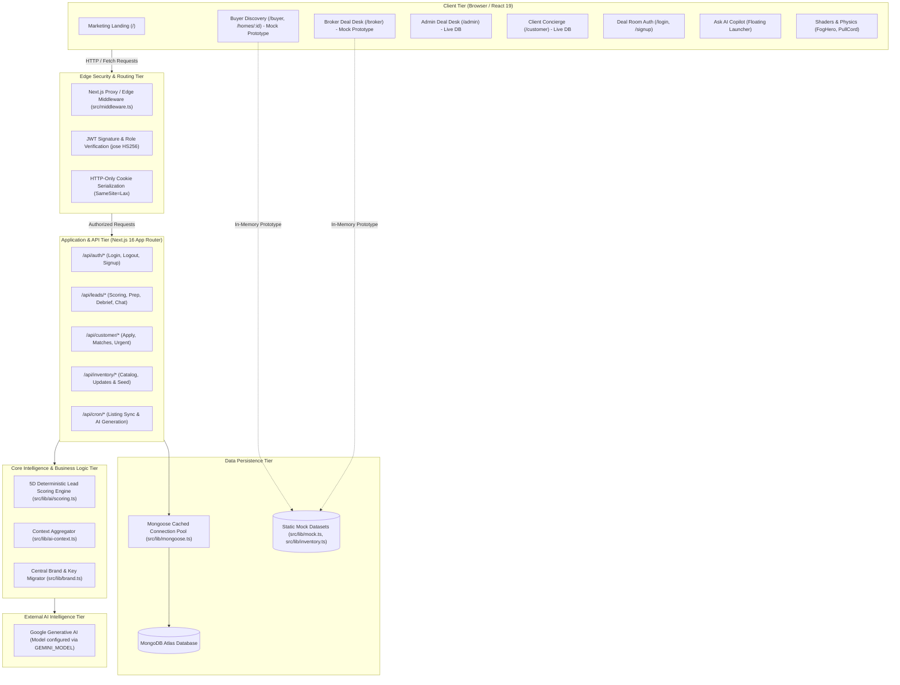

# Prospera AI — System Architecture & Integration Blueprint

> **File:** `c:\WEB DEVELOPMENT\Prospera AI\docs\ARCHITECTURE.md`  
> **Classification:** Technical Architecture Specification  
> **Brand Constant:** `BRAND_NAME = "Prospera"` (`src/lib/brand.ts`)  
> **Stack:** Next.js 16.3 (Turbopack, App Router), React 19.2, TypeScript 5, Tailwind CSS 4, MongoDB Atlas (Mongoose 9), Google Generative AI (`@google/generative-ai` with model configured via `GEMINI_MODEL`), Jose (HS256 JWT), Framer Motion 14, WebGL2 GLSL Shaders, Verlet Physics Engine.

---

## 1. High-Level Architectural Vision

**Prospera AI** is architected as an AI-assisted luxury real estate transaction platform. It unifies two operational paradigms into a single, cohesive full-stack application:

1. **The Sovereign Client Concierge (Customer-Facing):**  
   A cinematic, editorial portal for Ultra-High-Net-Worth (UHNW) property discovery, natural language international matching, confidential inquiry submission, and transaction milestone tracking.
2. **The Broker Deal Desk (Internal Operations):**  
   An AI-assisted deal room and advisory cockpit for luxury real estate brokers and administrators, featuring deterministic 5D AI lead scoring, automated pre-call briefings, post-call debrief note ingestion, and portfolio analytics.

---

## 2. End-to-End Connection & Request Lifecycles

### 2.1 User Authentication & RBAC Session Flow

Authentication is stateless and cryptographically secured using **HS256 JSON Web Tokens (JWT)** generated via `jose`, serialized into secure `HttpOnly`, `SameSite=Lax`, and `Secure` (production) cookies.

* **Login:** `POST /api/auth/login` verifies user credentials using bcrypt, signs the token, and sets the cookie.
* **Page-Level Protection:** `src/middleware.ts` intercepts requests, protecting `/admin` (admin only) and `/customer` (customer only).
* **API Route Protection:** Each protected API endpoint calls `requireAuth(req, allowedRoles)` from `src/lib/auth.ts`, returning `401 Unauthorized` if no valid token is provided and `403 Forbidden` if the user's role is not authorized.

---

### 2.2 Lead Qualification & Scoring Mechanics

Inquiries submitted by buyers or created by administrators are analyzed by the AI provider, run through the 5D mathematical scoring engine, categorized into priority tiers, and persisted:

1. **Extraction:** Google Generative AI (`GEMINI_MODEL`) evaluates the inquiry and returns structured ratings (0–10) across 5 dimensions:
   - `intent_strength` (Weight: 30% / `0.30`)
   - `timeline_urgency` (Weight: 25% / `0.25`)
   - `budget_fit` (Weight: 25% / `0.25`)
   - `engagement_quality` (Weight: 10% / `0.10`)
   - `information_completeness` (Weight: 10% / `0.10`)
2. **Deterministic Formula:**
   $$\text{Raw Score} = \left( \sum (\text{rating}_i \times W_i) \right) \times 10$$
   $$\text{Decay} = \min(15, \, \max(0, \, \text{daysSinceContact} - 1) \times 3)$$
   $$\text{Final Score} = \max(0, \, \min(100, \, \text{round}(\text{Raw Score} - \text{Decay})))$$
3. **Qualification Tiers:**
   - **HOT:** Score $\ge 70$ (marked `atRisk: true` if uncontacted for $\ge 3$ days)
   - **WARM:** Score $45 - 69$
   - **COLD:** Score $< 45$

---

## 3. Frontend-to-Backend Connection Matrix

| Frontend Page / Component | User Action | HTTP Method & Endpoint | Route Handler | Data Source | AI Models / External Services | Protected? / Roles |
| :--- | :--- | :--- | :--- | :--- | :--- | :--- |
| **`src/app/login/page.tsx`** | Pull cord bead / Submit credentials | `POST /api/auth/login` | `src/app/api/auth/login/route.ts` | MongoDB (`User`) | — (Bcrypt verification) | Public |
| **`src/app/signup/page.tsx`** | Register new client or broker | `POST /api/auth/signup` | `src/app/api/auth/signup/route.ts` | MongoDB (`User`) | — (Bcrypt hashing) | Public |
| **`src/components/ui/Navbar.tsx`** | Sign out of session | `POST /api/auth/logout` | `src/app/api/auth/logout/route.ts` | — (Clears HTTP cookie) | — | Public |
| **`src/app/page.tsx`** (Landing) | Mount / View curated collection | `GET /api/inventory` | `src/app/api/inventory/route.ts` | MongoDB (`Property`) | Unsplash CDN Images | Public |
| **`src/app/homes/[id]/page.tsx`** | Open luxury property detail | Direct component render | Page route | `src/lib/inventory.ts` | WebGL2 Procedural Fog | Public |
| **`src/app/buyer/page.tsx`** | Explore buyer prototype | Client-side interactions | UI Prototype | `src/lib/mock.ts` (Mock data) | — | Public prototype |
| **`src/app/broker/page.tsx`** | View broker pipeline prototype | Client-side interactions | UI Prototype | `src/lib/mock.ts` (Mock data) | — | Public prototype |
| **`src/app/admin/page.tsx`** | Load broker deal desk leads | `GET /api/leads` | `src/app/api/leads/route.ts` | MongoDB (`Lead`) | Real-time staleness decay | Protected (`admin`, `broker`) |
| **`src/app/admin/leads/new/page.tsx`** | Ingest new lead & score | `POST /api/leads` | `src/app/api/leads/route.ts` | MongoDB (`Lead`) | Google Gemini (`GEMINI_MODEL`) | Protected (`admin`, `broker`) |
| **`src/app/admin/leads/[id]/page.tsx`** | Request pre-call briefing | `GET /api/leads/:id/prep` | `src/app/api/leads/[id]/prep/route.ts` | MongoDB (`Lead`) | Google Gemini (`GEMINI_MODEL`) | Protected (`admin`, `broker`) |
| **`src/app/admin/leads/[id]/page.tsx`** | Submit post-call debrief notes | `POST /api/leads/:id/debrief` | `src/app/api/leads/[id]/debrief/route.ts` | MongoDB (`Lead`) | Google Gemini (`GEMINI_MODEL`) | Protected (`admin`, `broker`) |
| **`src/app/admin/leads/[id]/page.tsx`** | Conversational deal copilot | `POST /api/leads/:id/chat` | `src/app/api/leads/[id]/chat/route.ts` | MongoDB (`Lead`) | Google Gemini (`GEMINI_MODEL`) | Protected (`admin`, `broker`) |
| **`src/app/admin/leads/[id]/page.tsx`** | Mark deal as won | `POST /api/leads/:id/approve` | `src/app/api/leads/[id]/approve/route.ts` | MongoDB (`Lead`) | — | Protected (`admin`, `broker`) |
| **`src/app/admin/leads/[id]/page.tsx`** | Close lead with reason | `POST /api/leads/:id/close` | `src/app/api/leads/[id]/close/route.ts` | MongoDB (`Lead`) | — | Protected (`admin`, `broker`) |
| **`src/app/customer/page.tsx`** | Fetch client active applications | `GET /api/customer/applications` | `src/app/api/customer/applications/route.ts` | MongoDB (`Lead`) | Filtered to `user.name` | Protected (`customer`, `admin`) |
| **`src/app/customer/page.tsx`** | Submit buy/sell application | `POST /api/customer/apply` | `src/app/api/customer/apply/route.ts` | MongoDB (`Lead`) | — | Protected (`customer`, `admin`) |
| **`src/app/customer/page.tsx`** | Withdraw pending application | `DELETE /api/customer/apply` | `src/app/api/customer/apply/route.ts` | MongoDB (`Lead`) | Ownership check (`lead.name`) | Protected (`customer`, `admin`) |
| **`src/app/customer/page.tsx`** | Trigger urgency beacon | `POST /api/customer/urgent` | `src/app/api/customer/urgent/route.ts` | MongoDB (`Lead`) | Elevates to HOT 99 | Protected (`customer`, `admin`) |
| **`src/app/customer/page.tsx`** | Chat with concierge advisor | `POST /api/customer/chat` | `src/app/api/customer/chat/route.ts` | Google Gemini | Google Gemini (`GEMINI_MODEL`) | Protected (`customer`, `admin`) |
| **`src/app/customer/page.tsx`** | Global AI matchmaker search | `POST /api/customer/matches` | `src/app/api/customer/matches/route.ts` | Generative Simulation | Google Gemini (`GEMINI_MODEL`) | Protected (`customer`, `admin`) |
| **System Automation** | Background MLS listing sync | `POST /api/cron/sync` | `src/app/api/cron/sync/route.ts` | MongoDB (`Property`) | Google Gemini (`GEMINI_MODEL`) | Protected (`admin`, `broker`) |

*(Note: `src/app/api/inventory/[id]/route.ts` exports `PUT` and `DELETE` for property inventory modification; it does not export a `GET` method).*

---

## 4. Property Model Fields

The `Property` schema in `src/models/Property.ts` defines the following fields:
- `name`: string (required)
- `location`: string (required)
- `bhk`: string (required)
- `price`: string (required)
- `description`: string
- `images`: string array
- `features`: string array
- `createdAt` / `updatedAt`: Timestamps

---

## 5. Known Limitations

1. **Mock Data on `/broker` and `/buyer`:** The `/broker` and `/buyer` portals function as rapid front-end UI prototypes rendering static mock arrays from `src/lib/mock.ts`. The production database-backed workflows are situated in `/admin` and `/customer`.
2. **Generative Property Matchmaker:** `/api/customer/matches` and `/api/leads/[id]/matches` do not execute vector search queries against a real estate MLS database. Instead, they prompt Google Gemini to invent realistic luxury properties matching the buyer's query, paired with curated Unsplash imagery.
3. **No API Rate Limiting:** The API routes currently do not implement IP or token bucket rate limiting.
4. **Test Scope:** Automated tests currently cover the deterministic scoring engine (`src/lib/ai/scoring.test.ts`) and authentication middleware helpers (`src/lib/auth.test.ts`). Integration tests with a mock MongoDB instance are not yet configured.
