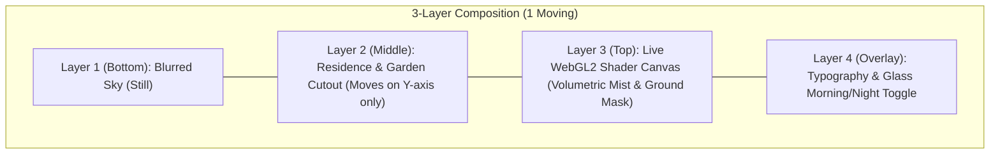

# Prospera AI — Frontend Architecture & UI/UX Design System

> **File:** `c:\WEB DEVELOPMENT\Prospera AI\docs\FRONTEND.md`  
> **Classification:** Frontend Engineering Specification  
> **Brand Constant:** `BRAND_NAME = "Prospera"` (`src/lib/brand.ts`)  
> **Framework:** Next.js 16.3 (Turbopack, App Router), React 19.2, TypeScript 5, Tailwind CSS 4, Framer Motion 14, WebGL2 GLSL Shaders, Verlet Physics Engine.

---

## 1. App Router Page Hierarchy & Route Architecture

The frontend is structured around the Next.js 16 App Router under `src/app/`. Routes are organized into functional zones: public marketing, client concierge, broker operations, and internal engineering laboratories.

```
src/app/
├── layout.tsx                     # Global App Shell, Typography, ToastProvider, AskAiLauncher
├── globals.css                    # Tailwind CSS 4, Theme Tokens, Shaders, Physics & Bevel styles
├── page.tsx                       # Cinematic Marketing Landing Page ("Find your next home in India")
├── login/page.tsx                 # Deal Room Authentication with Interactive Pull Cord Ceiling Lamp
├── signup/page.tsx                # Client & Broker Registration
├── buyer/page.tsx                 # Buyer Discovery Portal & Global Architectural Matchmaker
├── customer/page.tsx              # UHNW Client Concierge (Applications, Timeline, Urgency Escalation)
├── broker/
│   ├── page.tsx                   # Broker Deal Desk Overview & Pipeline Kanban
│   └── leads/[id]/page.tsx        # Broker Deal Cockpit for Individual Active Deals
├── admin/
│   ├── page.tsx                   # Executive Deal Room & Deterministic Priority Queue
│   ├── analytics/page.tsx         # Executive Analytics & Deal Velocity Dashboard (Recharts)
│   ├── inventory/page.tsx         # Luxury Inventory Audit & Listing Editor
│   ├── leads/[id]/page.tsx        # In-Depth Lead Debrief Cockpit (Pre-Call Prep, Debrief Notes)
│   └── leads/new/page.tsx         # Manual Deal Ingestion Desk with Instant AI Scoring
├── homes/[id]/page.tsx            # Single Property Luxury Showcase with WebGL2 Fog Transition
├── dev/
│   ├── ui/page.tsx                # Design System Laboratory & Component Showcase
│   └── fog/page.tsx               # WebGL2 Shader Testbench & Parameter Tuner
└── not-found.tsx                  # Custom Luxury 404 Experience
```

---

## 2. Page-by-Page Technical Breakdown

### 2.1 Marketing Landing (`/`)
* **Role:** High-impact initial brand impression for prospective buyers and luxury sellers.
* **Key Components:**
  * `<LandingHero />`: Auto-advancing 3-slide architectural carousel with giant display headlines, drifting volumetric cloud layers, and smooth cross-dissolves.
  * `<CityOrbitRail />`: Circular orbital city navigation nodes (Mumbai, Bengaluru, Hyderabad, Pune) with active radar pings.
  * `<SearchBar />`: Floating frosted search bar supporting budget range sliders, BHK filters, and AI prompt suggestions.
  * `<CuratedCollectionSection />`: Responsive grid of landmark properties featuring shared-element card-to-modal expansion.
  * `<ArchitecturalSpotlightSection />`: Editorial spotlight on landmark properties.
  * `<Footer />`: Brand statements, legal disclaimers, and links.

### 2.2 Deal Room Authentication (`/login`)
* **Role:** Secure authentication desk featuring the **DesignBookmark Pull Cord** interactive ceiling lamp.
* **Visual Experience:**
  * A realistic ceiling lamp hangs centered directly above the login card.
  * The user can physically drag the pull bead with a mouse or finger, tap it, or activate it via <kbd>Space</kbd>/<kbd>Enter</kbd>.
  * Tugging past the activation threshold pops the bulb, triggers a physical downward kick with rebound oscillation, and expands a circular light reveal wave from the filament to transform the room from Obsidian Night to Warm Dusk.
  * Form clearance: `pt-[240px] sm:pt-[290px]` guarantees the fixture never collides with or obscures input fields.

### 2.3 Buyer Discovery Portal (`/buyer`)
* **Role:** Architectural exploration interface for luxury property buyers.
* **Features:**
  * Real-time property filtering across tier, price, city, and amenities.
  * Natural language property search powered by AI matching.
  * 1-click confidential inquiry submission with instant AI qualification.

### 2.4 Customer Concierge Portal (`/customer`)
* **Role:** Private deal room for authenticated buyers tracking active applications.
* **Features:**
  * Active application status cards (Under Review, Viewing Scheduled, In Negotiation, Approved).
  * Milestone timeline displaying transaction progress.
  * **Urgency Escalation Beacon:** A dedicated action button that elevates the deal score to **HOT 99** and alerts the broker.
  * Dedicated concierge AI chat for viewing coordination.

### 2.5 Broker Deal Desk & Admin Cockpit (`/admin`, `/broker`)
* **Role:** Mission control for luxury brokers and deal captains.
* **Features:**
  * Prioritized inquiry list sorted deterministically by 0–99 AI score.
  * Filter tabs: *All Deals*, *Hot to Call* ($\ge 75$), *At Risk* (Staleness penalty $> 72\text{h}$).
  * Instant status badges indicating missing information, budget fit, and next actions.
  * `<Sidebar />` with navigation links and active deal team indicator (**Pranjal**).

### 2.6 Lead Debrief Cockpit (`/admin/leads/[id]`)
* **Role:** Pre-call briefing and post-call debrief extraction desk.
* **Features:**
  * **1-Click Pre-Call Prep:** Generates opening icebreakers, discovery questions, and tailored objection counters before dialing.
  * **Call Debrief Ingestion:** Allows the broker to paste raw notes from phone calls; AI extracts updated requirements and recalculates the 5D score automatically.
  * **Conversational Deal Copilot:** Interactive chat panel for drafting custom WhatsApp follow-ups, emails, or negotiation counter-offers.

### 2.7 Property Detail Showcase (`/homes/[id]`)
* **Role:** Full-screen editorial showcase for a single luxury estate.
* **Features:**
  * **WebGL2 Morning / Night Fog Transition Hero:** An interactive scene where toggling Morning/Night sinks the residence into volumetric mist, shifts the lighting, and floats the estate back up in the new atmosphere.
  * Specification grids: Carpet area, ceiling height, facing, RERA verification, parking bays, and maintenance fees.

---

## 3. Signature Motion, Physics & Shader Systems

### 3.1 DesignBookmark Pull Cord Ceiling Lamp (`<PullCord />`)
Located in [`src/components/ui/PullCord.tsx`](file:///c:/WEB%20DEVELOPMENT/Prospera%20AI/src/components/ui/PullCord.tsx), this component ports the official DesignBookmark motion study into a React 19 component with zero external physics libraries.

```
       Ceiling Anchor [W/2, -4]
               │
               │  Thin Suspension Wire
               │
          [Cap: #2a2e37]
      ┌────────────────────┐
      │  Half-Circle Dome  │  [Dark Ink Shade: #171a21]
      │       Shade        │
      └──────┬──────┬──────┘
             │(Bulb)│  [Spherical Bulb: #ffd23f (ON) / Glassy Grey (OFF)]
             └──────┘
                    \
                     \  Physical Verlet Rope (12 nodes, 2600 px/s² gravity)
                      \
                      [Bead: #ffffff Porcelain Pill]
```

#### Exact Physics Constants
* **Lamp Tilt Angle (`TH`):** Spring $k = 46, c = 3$. Tilts realistically when the cord is pulled off-center.
* **Vertical Tension (`TUG`):** Spring $k = 300, c = 13$. Imparts vertical displacement and a $+150\,\text{px/s}$ kick when the switch clicks.
* **Light Expansion Wave (`R`):** Open $k = 120, c = 21$; Close $k = 170, c = 27$. Controls the circular `clip-path` expansion.
* **Bulb Scale Pop (`BP`):** Spring $k = 420, c = 13$. Scale pops to $1.35\times$ on switch-on, $0.8\times$ on switch-off.
* **Ghost Pull Trajectory (`HX`, `HY`):** Spring $k = 210, c = 22$. Drives smooth animation for tap events and idle hints.
* **Cord Elasticity (`K`):** Spring $k = 300, c = 17$. Controls non-linear rubber cord extension.

#### Verlet Rope Simulation Mechanics
1. **Nodes:** 12 discrete particles with $9\text{px}$ rest length ($7.2\text{px}$ on mobile).
2. **Sub-stepping:** 4 simulation sub-steps per frame inside `requestAnimationFrame`.
3. **Constraint Relaxation:** 8 passes per sub-step to enforce distance invariants.
4. **Trigger Threshold:** Clicks when cord stretch exceeds $22\text{px}$ ($17.6\text{px}$ on mobile); max stretch capped with exponential damping at $54\text{px}$.
5. **Reduced Motion:** If `prefers-reduced-motion` is detected, springs apply critical damping ($c = 2\sqrt{k}$) to eliminate oscillatory bounce.
6. **Responsive Scaling:** On mobile ($\le 480\text{px}$), the entire fixture scales to **80%** ($0.8\times$) with $36\text{px}$ ceiling wire.

---

### 3.2 WebGL2 Morning / Night Fog Hero (`<FogHero />`)
Located in [`src/components/listing/FogHero.tsx`](file:///c:/WEB%20DEVELOPMENT/Prospera%20AI/src/components/listing/FogHero.tsx), this component implements a procedural volumetric fog transition across 3 parallax layers:



#### The 1800ms Time-Shift Transition Sequence
1. **0ms – 800ms (The Sink):** Clicking the Morning/Night toggle drives the residence layer $25\%$ down the screen while volumetric fog surges upward over the roof.
2. **800ms (The Swap Point):** At maximum fog opacity, the sky background texture, lighting uniforms, and time-of-day flags swap instantaneously while hidden.
3. **800ms – 1800ms (The Rise):** The residence floats smoothly back up to rest position in the new ambient light as the fog subsides to baseline density.

#### GLSL Fragment Shader Highlights
* Multi-octave Perlin-Simplex procedural noise generating organic, non-repeating mist ribbons.
* Uniform variables:
  * `u_time`: Drives continuous horizontal wind drift.
  * `u_density`: Modulates baseline fog thickness ($0.15 \to 0.95$ during surge).
  * `u_light_tint`: Interpolates between crisp morning gold (`#fffaed`) and deep night slate (`#0c1420`).

---

### 3.3 VengeanceUI Kinetic Generate Button (`<GenerateButton />`)
Located in [`src/components/ui/GenerateButton.tsx`](file:///c:/WEB%20DEVELOPMENT/Prospera%20AI/src/components/ui/GenerateButton.tsx):

* **Visual Tokens:** Pill geometry with double inset white bevel shadows, 1px translucent border, and an ambient halo ring (`::before`).
* **Rising Hue Highlight:** An ambient highlight gradient (`::after`) emerges from the bottom edge on hover, active click, and generation states (`--gen-hue: 37` in luxury gold, `265` in telemetry purple).
* **Kinetic Letter Wave:** Text characters brighten sequentially on hover. During generation, the label blurs and scales into the progress text with a pulsing highlight.
* **Strict Policy:** Reserved strictly for true AI synthesis actions (e.g., *Generate Briefing*, *AI Search*, *Synthesize Listing*).

---

### 3.4 Apple VisionOS Liquid Glass (`<LiquidGlass />`)
Located in [`src/components/ui/LiquidGlass.tsx`](file:///c:/WEB%20DEVELOPMENT/Prospera%20AI/src/components/ui/LiquidGlass.tsx):

* **Specular Rim Highlights:** Border styled with `1px solid rgba(255, 255, 255, 0.14)` in dark mode and `1px solid rgba(255, 255, 255, 0.7)` in light mode.
* **Backdrop Filtration:** Native `backdrop-filter: blur(20px)` paired with multi-layer box shadows to produce realistic refraction depth.

---

### 3.5 Gooey Spring AI Copilot Launcher (`<AskAiLauncher />`)
Located in [`src/components/ai/AskAiLauncher.tsx`](file:///c:/WEB%20DEVELOPMENT/Prospera%20AI/src/components/ai/AskAiLauncher.tsx):

* Fixed in the bottom-right corner across all application routes.
* **Collapsed State:** Compact $100\times40\text{px}$ pill with sparkle icon and "Ask AI".
* **Expanded State:** Morphs via an SVG gooey filter spring into a $320\text{px}$ input field.
* **Staggered Suggestion Chips:** 3–4 context-aware prompt chips rise upward with a $120\text{ms}$ blur-to-sharp spring.
* **Full Chat Panel:** Submitting launches the full `<AiChatPanel />` with streaming conversational responses.

---

## 4. Theme System & Design Tokens

Prospera AI features a dual-theme system toggled via the Pull Cord lamp on `/login` or `<ThemeToggle />`:

### 4.1 Dark Theme (Obsidian Night)
* **Canvas Backdrop:** Deep Obsidian `#0a0d12` with dark slate `#101720`.
* **Typography:** Frost white `#f4f5f8` with muted slate `#8c94a0`.
* **Accent:** Warm luxury amber `#e8a33b` (hover `#f5bf68`).
* **Telemetry Accents:** Cyan `#00F5D4` and Electric Blue `#38BDF8` for AI indicators.
* **Panels:** Frosted dark glass with specular edge bevels.

### 4.2 Light Theme (Warm Dusk)
* **Canvas Backdrop:** Warm peach gradient `#fbe7da` to `#f7d9c6`.
* **Typography:** Deep ink `#1d1a1c` with muted charcoal `#5c5156`.
* **Accent:** Rich amber-gold `#c97d1e` (hover `#9e5c09`).
* **Panels:** Frosted white glass with translucent amber shadows.

---

## 5. Responsive Design Breakpoint Matrix

| Component | Desktop ($\ge 1024\text{px}$) | Tablet ($768\text{px} - 1023\text{px}$) | Mobile ($\le 480\text{px}$) |
| :--- | :--- | :--- | :--- |
| **Pull Cord Lamp** | Scale $1.0\times$, Wire $72\text{px}$ | Scale $1.0\times$, Wire $52\text{px}$ | Scale $0.8\times$, Wire $36\text{px}$ |
| **Login Card Spacing** | `pt-[290px]`, Max $448\text{px}$ width | `pt-[290px]`, Max $448\text{px}$ width | `pt-[240px]`, Full width with $16\text{px}$ margins |
| **Landing Hero** | 3-column orbit rail + giant titles | 2-column stacked orbit rail | Vertical flow, carousel controls bottom |
| **Ask AI Launcher** | $320\text{px}$ expanded pill, $380\times560\text{px}$ chat panel | $320\text{px}$ expanded pill | Full-width bottom sheet |
| **Broker Desk** | 5-stage horizontal Kanban board | 2-stage scrollable grid | Single-column accordion list |
